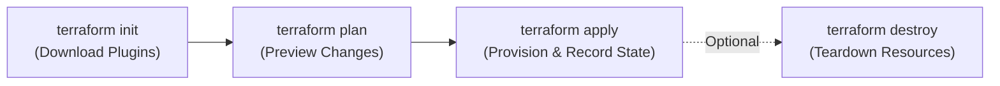

> https://github.com/sidpalas/devops-directive-terraform-course
> https://youtu.be/7xngnjfIlK4
> Use above as the reference

# Terraform Overview & Architecture

## What is Terraform ?

Terraform is a tool for building, changing and versioning infra safely and efficiently

- Enables application software best practices to infra (because we use are provisioning Infra via Code, we can follow the best practices we do for code. Eg: version tracking)
- Platform agnostic 

## Terraform Architecture

![[terraform/_assets/Pasted image 20261011153600.png]]

Uses HashiCorp Configuration Language (HCL) to declare your desired infrastructure end-state, leaving Terraform to calculate dependencies and execute the changes.

### Under the Hood: Core vs. Plugins

Terraform's architecture is divided into two distinct logical layers:

1. **Terraform Core (The Engine / Brain):**
   - **Configuration Parser:** Parses your `.tf` files written in HashiCorp Configuration Language (HCL).
   - **State Manager:** Reads, writes, and reconciles the `terraform.tfstate` ledger.
   - **Resource Graph Builder:** Constructs a Directed Acyclic Graph (DAG) representing every resource and dependency. This allows Terraform to determine which resources can be built simultaneously in parallel and which must be built sequentially.
   - **Diff Engine:** Calculates the minimal execution delta by comparing Desired State (code) vs. Last Known State (state file) vs. Actual State (cloud API).

2. **Terraform Providers (The Plugins / Hands):**
   - Standalone executables written in Go that run as separate background processes on your machine.
   - Communicate with **Terraform Core** over high-performance local **gRPC** (Remote Procedure Call) sockets.
   - Translate Terraform's universal CRUD operations (`Create`, `Read`, `Update`, `Delete`) into vendor-specific REST API calls (e.g., calling AWS EC2 endpoints or Cloudflare DNS endpoints).
   - Because providers are decoupled plugins, anyone can write and distribute a custom provider without modifying the Terraform Core engine.

---

## Key Aspects of Terraform

- **Declarative Language (HCL)**: You write `.tf` files describing what infrastructure you want (like virtual machines, subnets, or databases) rather than coding step-by-step procedural commands on how to build them.
- **Provider Ecosystem**: Terraform uses plugins called **providers** to communicate with APIs for various platforms, supporting major cloud providers like AWS, Azure, and Google Cloud Platform, as well as tools like Kubernetes and GitHub.
- **State Management**: It maintains a persistent state file (`terraform.tfstate`) that maps your configuration code to real-world infrastructure objects, acting as the single source of truth for your environment.
- **The Core Workflow**: Operations follow a strict, reliable lifecycle: `terraform init` (sets up providers), `terraform plan` (previews changes), `terraform apply` (deploys changes), and `terraform destroy` (tears down resources).
- **Multi-Cloud and Reusability**: It enables cloud-agnostic deployments and supports modular configuration blocks called modules, allowing teams to share and reuse standard infrastructure patterns.

### The Core Lifecycle Workflow in Depth

| Command | Primary Action | Under the Hood |
| :--- | :--- | :--- |
| `terraform init` | Prepares working directory | Downloads provider binaries into `.terraform/` and generates `.terraform.lock.hcl`. |
| `terraform plan` | Dry-run preview | Queries live cloud APIs, refreshes state, computes the DAG graph, and displays planned diff (`+` create, `~` modify, `-` destroy). |
| `terraform apply` | Executes infrastructure build | Prompts for confirmation (unless `-auto-approve`), issues API calls via providers in topological dependency order, and updates `terraform.tfstate`. |
| `terraform destroy` | Tears down infrastructure | Reverses the DAG dependency graph to delete child resources before parent resources, safely destroying all tracked infrastructure. |
