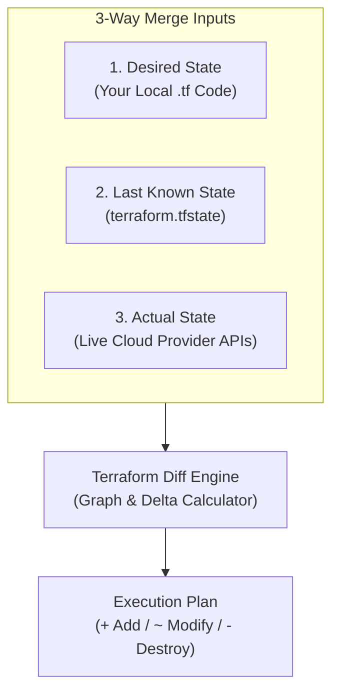

# Why Terraform Needs a State File: A Deep Dive

## The Big Picture: Why We Need It

The existence of the state file is required because it is impossible to poll the entire state of a cloud provider.

Think about AWS, Azure, or Google Cloud. They are massive. If Terraform had to scan your entire cloud account to find your resources every single time you ran a command, it would take forever and instantly crash your cloud API limits.

To solve this, Terraform uses a state file as a scoped registry. It’s essentially a precise checklist that says, _"Here are the exact resource IDs that belong to this specific project. Don't look at anything else."_

---

## Step-by-Step: How Terraform Creates and Uses the File

Here is the exact lifecycle of how that file is born and used:

- **The First Run (The Blank Slate)**: When you create a project for the first time, there is no state file. When you run `terraform plan`, Terraform looks for that file, finds nothing, and assumes it’s starting completely from scratch. It doesn't poll AWS yet because it has no IDs to ask for. It just reads your code and says, _"Okay, I need to create these brand-new items."_
- **The Birth of the State File**: The very first time your changes are successfully applied (`terraform apply`), it creates a state file tracking exactly what was provisioned. The second AWS says "Success," Terraform writes down the real-world IDs (like `bucket-name-123` or `i-0abc123`) into a JSON file on your machine.
- **The Next Run (Active Polling)**: This state file is then used for your next `plan` or `apply` as the baseline mapping. But Terraform isn't lazy—it doesn't just blindly assume the state file is 100% correct. Instead, it reads the IDs from the state file and goes out to actively poll those specific resources in the cloud to see what they look like _right now_. The exact process is as below:
	- **Read Registry:** It reads the state file to grab the specific resource IDs it owns.
	- **Active Polling:** It uses those specific IDs to actively poll the cloud provider's live APIs for their real-time configurations.
	- **Diff Calculation:** It compares your local code (Desired State), the state file (Last Known State), and the live API data (Actual State) to compute the minimal changes required.

### The 3-Way Reconciliation Diff



---

## The Reality Check: Tracked vs. Untracked Resources

* **Tracked** = Exists in the state file somewhere (existence in state file implies that it was created using the terraform project)
* **Untracked** = Created outside of terraform, perhaps manually on the cloud GUI. Terraform is unaware of its existence.

Because of how this polling mechanic works, your cloud management breaks down into two very clean categories:

- **Catching Drift (Tracked Resources)**: If a change is made to a tracked resource outside of Terraform—like an engineer logging into the AWS Console and manually changing a server size—Terraform is smart enough to catch this drift. Why? Because that server's ID is in the state file, so Terraform actively checks its real-time API status during the next run and notices the mismatch.
- **The Blind Spot (Untracked Resources)**: This also means that any changes made to non-tracked resources are purely uncaught. If someone manually spins up a brand-new database or virtual machine outside of Terraform, it is completely invisible. Because its ID isn't in your state file, Terraform never polls it, never flags it, and has no idea it exists.

> [!CAUTION]
> **The Nightmare Scenario (Deleting the File)**:
> If you delete that state file, Terraform's memory is wiped. It assumes the project is brand new. When you run `apply`, it will blindly try to recreate everything from scratch, resulting in massive naming collision errors or creating duplicate, orphaned infrastructure that will bloat your cloud bill. 
> 
> *(If this ever happens, look into `terraform import` to manually re-link existing cloud resource IDs back into a fresh state file).*

---

## 💡A Fun Thought Experiment: Is `apply` secretly `destroy`?

Is `tf destroy` the same as doing `tf apply` with an empty `main.tf` file (no resources), but with using current state file?

Assume that we have a live project with existing resources on the cloud provider. Now if you run `tf destroy` it will wipe all tracked resources. If you were to instead just remove all resources from the main tf file, but keep the state file intact with no modifications, and then run `tf apply` would the outcome be the same as running `tf destroy` ?

**YES !!** Because Terraform is purely declarative, it only cares about your destination. It does the math by comparing your current reality (what is in the state file) against your desired end-state (what is in your code).

If your state file tracks 5 running servers, but your freshly emptied code says you want 0 servers, Terraform calculates the shortest path to make them match. It will cheerfully spit out a plan to destroy all 5 resources.

The only catch? You have to leave your `provider` block intact so Terraform still has the API keys and credentials needed to execute the teardown!

> [!NOTE]
> It's a great look into how the engine thinks. Are you ready to see some real HCL code for setting up resources, or do you want to dive into modules?

---

## Production Reality: Remote State & State Locking

In production team environments, storing `terraform.tfstate` on a developer's local hard drive is an anti-pattern:
1. **Concurrency Hazards:** Two developers running `terraform apply` at the same moment will produce race conditions and overwrite each other's state.
2. **Security Leaks:** State files contain plain-text metadata, including passwords, private keys, and connection strings.
3. **Data Loss:** If a laptop crashes, the entire record of cloud infrastructure is lost.

### The Solution: Remote Backends

Teams configure a **Remote Backend** to store the state file in a centralized, secure object store with automated distributed locking.

```hcl
terraform {
  backend "s3" {
    bucket         = "my-company-terraform-states"
    key            = "networking/prod.tfstate"
    region         = "us-east-1"
    dynamodb_table = "terraform-state-locks" # Provides distributed mutex locking
    encrypt        = true                    # Server-side AES-256 encryption
  }
}
```

* **Storage (e.g., AWS S3, Azure Blob, GCS):** Keeps state centralized, versioned, and encrypted at rest.
* **Locking (e.g., AWS DynamoDB):** Creates a mutex lock whenever someone runs `plan` or `apply`, halting any other team member from modifying the state until the current execution finishes.

## 💡 Thought Experiment: Will Hidden AWS Dependencies Stiff You with a Surprise Bill?

Here is an excellent question that everyone runs into when they start thinking about how Terraform interacts with the cloud:

> "If I write a Terraform script to deploy a resource on AWS, but that resource implicitly deploys another resource as a hidden dependency to function, will Terraform track it? If I run `terraform destroy`, will it only remove the original resource and leave me getting billed for the untracked dependency?"

The short answer is: No, you won’t get stuck with a surprise bill from AWS, but it depends entirely on _who_ created that hidden dependency.

Your intuition is 100% correct—Terraform is completely blind to anything that isn't explicitly written down in its `terraform.tfstate` file. However, you are safe from hidden bills because of how the AWS API handles things under the hood.


### The Two Ways AWS Handles Dependencies

- AWS-Managed Background Resources (You are Safe): When you use Terraform to deploy a high-level service—like an Amazon EMR cluster or AWS Directory Service—AWS automatically spins up underlying EC2 instances, network interfaces, and storage volumes in the background to make it work. Terraform has no idea these exist. But when you run `terraform destroy`, Terraform tells the master AWS API, _"Delete the EMR cluster."_ Because AWS owns the background components, the AWS API automatically cleans up its own room, wiping out all those underlying servers along with it.
- The Raw API Reality Check (No Magic Defaults): If you've ever built a server using the AWS Web Console GUI, you know it automatically creates a default security group or an internet gateway for you behind the scenes. The raw AWS API does not do this. When you use Terraform, it talks to the raw API. If you don't explicitly write code for the subnets, security groups, and routing tables, Terraform will simply crash with a missing dependency error. Because it forces you to write them out to make the project work, they are all perfectly tracked in your state file and cleaned up on a `destroy`.

### The Real Danger Zone: "App-Level Cloud Ghosts"

There is exactly one scenario where your nightmare comes true: when your application code inside a server creates cloud resources behind Terraform's back.

Imagine you use Terraform to deploy a clean Kubernetes cluster (AWS EKS). Everything looks perfectly tracked and clean in your state file. But the moment a developer or an app inside that cluster runs a script to deploy an application, Kubernetes bypasses Terraform completely. It goes directly to AWS via its own permissions to spin up real, expensive network load balancers or storage drives.

When you run `terraform destroy` on Friday afternoon to save money, Terraform cleanly tears down your master cluster and declares a job well done. But behind the scenes, those dynamically attached storage drives and load balancers are left running as orphans. Terraform has no idea they exist, so it leaves them behind—and AWS will quietly keep billing your credit card until you manually hunt them down in the GUI console!

Have you ever run into these orphaned cloud ghosts before, or would you like to see how platform teams use automated sweepers like AWS Nuke to clean up the mess?

---
